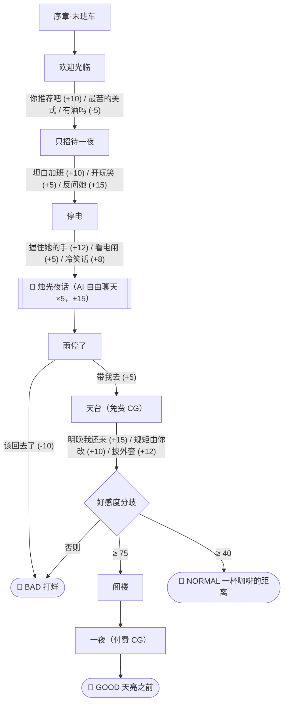

# 一夜咖啡馆 · One Night Café

> 23:47，方案第七次被打回，末班车刚好开走。
> 你躲进一条从没走过的小巷，推开了一家只在夜里营业的咖啡馆的门——
> 「本店规矩：每位客人，只招待一夜。」

H5 剧情互动（galgame）Demo：1 位女主、3 个场景、13 个剧情节点、5 个选项点、1 段 AI 自由聊天、3 个结局，关键剧情 CG 需付费解锁。

- **技术栈**：Node.js（Express 5）+ 原生 ES Modules 前端（无构建步骤）+ WebAudio + Claude API
- **试玩**：本地 `npm start` 后打开 <http://localhost:3000>（部署方式见文末）
- **统计看板**：<http://localhost:3000/stats.html>

---

## 目录

1. [怎么运行](#1-怎么运行)
2. [整体架构](#2-整体架构)
3. [剧情 JSON 格式说明](#3-剧情-json-格式说明)
4. [需求完成情况 & 加分项](#4-需求完成情况--加分项)
5. [每部分耗时](#5-每部分耗时)
6. [AI 工具使用说明](#6-ai-工具使用说明)
7. [部署](#7-部署)

---

## 1. 怎么运行

需要 **Node.js ≥ 20.12**（内置 `.env` 读取）。

```bash
npm install
npm start            # http://localhost:3000
```

可选：开启 AI 自由聊天（不配置也能完整游玩，会自动使用离线规则回复）

```bash
cp .env.example .env
# 编辑 .env，填入 ANTHROPIC_API_KEY=sk-ant-...
npm start
```

其他命令：

| 命令 | 作用 |
| --- | --- |
| `npm run dev` | 开发模式，改服务端代码自动重启 |
| `npm test` | 单元测试 + 服务端集成测试（引擎跑通三条结局路线、付费鉴权、聊天裁剪、统计口径） |
| `npm run validate` | 校验 `story/story.json`（断链、引用不存在的表情/场景/CG、条件语法、可达性） |
| `npm run graph` | 由剧情 JSON 生成 Mermaid 流程图 |

小技巧：地址后加 `?debug` 会在画面左上角显示当前节点、好感度和 flags，方便调剧情。

---

## 2. 整体架构

```
┌──────────────────────────── 浏览器（public/）────────────────────────────┐
│  main.js  启动：拉剧情 → 预加载(进度条) → 点击进入(解锁音频) → 标题        │
│                                                                          │
│  ui/Game.js  游戏控制器 ── 把引擎的 step 渲染到画面，处理输入/自动/快进     │
│     ├─ Stage      背景/立绘/CG 双缓冲淡入淡出、雨、闪光、震屏、色调          │
│     ├─ Dialogue   打字机对话框          ├─ Hud      好感度条 + 飘字        │
│     ├─ choices    选项                  ├─ Chat     AI 聊天面板            │
│     ├─ Paywall    付费墙 + 模拟收银台    └─ menus    存读档/历史/设置/回想  │
│     │                                                                    │
│  engine/  ★ 纯逻辑，无 DOM，浏览器和 Node 共用                            │
│     ├─ StoryEngine.js   剧情状态机（state 可序列化 = 存档）               │
│     ├─ conditions.js    条件表达式 / 效果                                 │
│     └─ validate.js      剧情校验（服务端加载时 + CLI + 测试）              │
│                                                                          │
│  services/  api · analytics(批量埋点+sendBeacon) · storage(存档/设置)      │
│             audio(WebAudio 合成 BGM/音效/雨声) · preload                  │
└──────────────────────────────────┬───────────────────────────────────────┘
                                   │ 同源 JSON API + 签名 Cookie（匿名身份）
┌──────────────────────────────────▼──────────── Node 服务（server/）──────┐
│  index.js     静态资源 · /api/story(热更新+校验) · /api/session · 埋点     │
│  routes/pay   下单 → 确认(模拟支付回调) → 记录解锁 · /api/cg/:id 鉴权取图  │
│  routes/chat  AI 聊天会话（服务端保存历史、裁剪好感度、限流）              │
│  llm/         Claude（结构化输出）/ 离线规则兜底，失败自动降级              │
│  stats.js     漏斗/流失/选项比例/付费转化/结局分布聚合                     │
│  store.js     db.json（用户/订单/解锁，原子写）+ events.jsonl（埋点）       │
│  protected/   付费 CG 原图（不在 public 下，只能经鉴权接口取）              │
└──────────────────────────────────────────────────────────────────────────┘
```

### 几个关键设计

**引擎和渲染分离。** `StoryEngine` 只回答"现在该显示什么"（一句台词 / 一组选项 / 聊天 / 结局），状态是一个纯 JSON 对象：存档就是 `snapshot()`，读档就是 `load()`。同一份引擎代码在 Node 里跑单元测试（自动玩通三条结局路线），在服务端用于剧情校验和统计漏斗排序。

**舞台状态由引擎记录，表现由 UI 决定。** 台词里的 `scene / expression / cg / bgm / weather` 在"落地"时写进 `state.stage`；UI 每次渲染只做"把画面同步到 stage"，是幂等的。所以读档时画面、BGM、天气能完整还原，快进时也不会漏切换。

**付费 CG 的可信边界在服务端。**
- 原图放在 `server/protected/`，不在静态目录，猜 URL 也拿不到；每次 `GET /api/cg/:id` 都查解锁记录。
- 用户身份是**签名** Cookie（httpOnly），前端改不了别人的 uid。
- 下单金额以服务端剧情配置为准，忽略前端传值；订单只能由下单本人确认；确认接口幂等（模拟支付平台重复回调）。
- `pay_success` 埋点只认服务端写入，前端上报的会被丢弃，避免刷收入。
- 下发给前端的剧情 JSON 会去掉付费 CG 的原图路径和 AI 人设。

**AI 聊天的状态也在服务端。** 历史消息保存在服务端会话里，前端只发一句话，没法伪造 assistant 消息做注入；单轮好感度 ±5、单段聊天累计 ±15 在服务端裁剪；每用户每分钟限流。

**剧情热更新。** 服务端按 `story.json` 的 mtime 缓存，改完 JSON 刷新页面即可生效，不用重启。JSON 写错时不会白屏，而是把校验错误逐条显示在游戏里。

### 目录

```
story/story.json          剧情配置（唯一需要策划改动的文件）
public/                   前端（index.html 游戏 · stats.html 统计看板）
  js/engine/              剧情引擎（前后端共用）
  js/ui/ js/services/     渲染与服务
  assets/                 背景 / 立绘 / CG 占位图（SVG，由 scripts/gen-art.mjs 生成）
server/                   Node 服务
  protected/cg/           付费 CG 原图
scripts/                  validate-story / story-graph / gen-art
test/                     node:test 测试
data/                     运行时数据（订单、解锁、埋点；已 gitignore）
```

---

## 3. 剧情 JSON 格式说明

剧情全部写在 [`story/story.json`](story/story.json)。改这个文件就能改剧情、选项、好感度、分支条件、AI 人设和付费 CG 价格，不需要改代码。

### 3.1 顶层结构

```jsonc
{
  "meta":       { "title": "一夜咖啡馆", "version": "1.0.0", "start": "prologue", "titleBg": "...", "titleBgm": "title" },
  "settings":   { "affection": { "name": "好感度", "initial": 30, "min": 0, "max": 100,
                                 "markers": [{ "value": 75, "label": "好结局线" }] } },
  "characters": { "wan": { "name": "林晚", "color": "#ffa3bd", "sprites": { "normal": "…svg", "smile": "…" }, "persona": { … } },
                  "player": { "name": "我" } },
  "scenes":     { "cafe": { "name": "一夜咖啡馆", "bg": "assets/bg/cafe_night.svg", "bgm": "cafe", "weather": "rain", "tint": null } },
  "audio":      { "bgm": { "cafe": { "synth": "cafe" } }, "sfx": { "bell": { "synth": "bell" } } },
  "cgs":        { "cg_night": { "title": "天亮之前", "paid": true, "price": 6, "currency": "CNY",
                                "file": "cg/cg_night.svg", "preview": "assets/cg/cg_night_preview.svg" } },
  "endings":    { "good": { "title": "天亮之前", "label": "GOOD END", "description": "…" } },
  "nodes":      { "prologue": { … }, "meet": { … } }
}
```

- `audio` 里每一项可以是 `{ "src": "assets/audio/xx.mp3" }`（真实音频文件）或 `{ "synth": "cafe" }`（内置合成音色）。
- `cgs` 里免费 CG 用 `image`（公开路径）；付费 CG 用 `file`（相对 `server/protected/` 的路径，**不会下发给前端**）+ `preview`（未解锁时的模糊预览）。
- `scenes.*.tint` 可选 `"dawn"`，给同一张背景叠清晨色调（例如结局用夜景背景做出天亮的感觉）。

### 3.2 节点（node）

每个节点 = 一段台词 + **恰好一个出口**：

| 出口 | 写法 | 说明 |
| --- | --- | --- |
| 直接跳转 | `"next": "counter"` | 台词播完自动进入下一个节点 |
| 选项 | `"choices": [ … ]` | 见下文 |
| 条件分支 | `"branch": [{ "if": {…}, "next": "loft" }, …, { "next": "closing" }]` | 从上到下取第一个满足条件的；**最后一项必须无条件兜底**（校验器会检查） |
| AI 聊天 | `"chat": { "character": "wan", "rounds": 5, "maxAffection": 15, "context": "…", "opening": "…", "suggestions": [ … ], "next": "rain_stops" }` | 进入自由聊天，`context` 会写进大模型的场景描述 |
| 结局 | `"ending": "good"` | 台词播完后弹出结局卡片 |

节点可选字段：`title`（存档列表和统计页显示用）、`scene`、`bgm`、`weather`、`prompt`（选项出现时对话框里的提示语）、`effects`（进入节点时生效）。

```jsonc
"meet": {
  "title": "欢迎光临",
  "scene": "cafe",
  "lines": [
    { "text": "暖气和咖啡豆的香味一起扑了过来。" },                       // 没有 speaker = 旁白
    { "speaker": "wan", "expression": "surprised", "text": "……哇。你这是刚从河里捞上来的吗？" },
    { "speaker": "player", "text": "……" }                              // 主角
  ],
  "prompt": "点一杯什么？",
  "choices": [
    {
      "text": "「你推荐吧，我相信老板的眼光。」",
      "effects": { "affection": 10 },
      "lines": [ { "speaker": "wan", "expression": "smile", "text": "哦？胆子不小嘛。" } ],  // 选完后的反应台词（可选）
      "next": "counter"
    },
    {
      "text": "「有……酒吗？」",
      "effects": { "affection": -5, "flags": { "asked_wine": true } },     // flag 可以在后面的剧情里引用
      "next": "counter"
    },
    {
      "text": "（隐藏选项）",
      "if": { "affection": { "gte": 60 } },        // 不满足时隐藏；
      "lockedHint": "好感度 ≥ 60",                 // 写了 lockedHint 则显示为锁定状态
      "next": "secret"
    }
  ]
}
```

### 3.3 台词（line）字段

| 字段 | 说明 |
| --- | --- |
| `text` | 台词文本。**没有 `text` 的行是纯舞台指令**（只换背景/表情/CG），立即生效不停顿 |
| `speaker` | 角色 id；`player` 为主角；省略为旁白 |
| `expression` | 切换说话角色的表情（淡入淡出）；也可以用 `char` + `expression` 指定其他角色 |
| `hide` | `true` 隐藏立绘 |
| `scene` / `bgm` / `weather` | 句中切换场景 / BGM（`null` 静音）/ 天气（`"rain"` 或 `null`） |
| `cg` | 显示 CG（`null` 关闭）。付费 CG 未解锁时会自动弹出付费墙 |
| `sfx` | 播放音效 |
| `fx` | 画面特效：`"flash"` 闪光、`"shake"` 震屏 |
| `if` | 条件台词：不满足则跳过这一句（用来写同一段剧情的好感度差分） |
| `effects` | 这句台词出现时生效的效果 |

### 3.4 条件（`if`）与效果（`effects`）

```jsonc
{ "affection": { "gte": 75 } }               // 好感度比较：gte / gt / lte / lt / eq / ne，可组合 {"gte":40,"lt":75}
{ "flag": "promise" }                        // flag 为真
{ "notFlag": "left_early" }                  // flag 为假或不存在
{ "flags": { "route": "a", "count": { "gte": 2 } } }
{ "visited": "rooftop" }                     // 到达过某节点
{ "all": [ … ] } / { "any": [ … ] } / { "not": { … } }
// 同一个对象里写多个 key 是 AND 关系
```

```jsonc
"effects": { "affection": 10, "flags": { "held_hand": true } }   // 好感度增减（自动裁剪到 min~max）、设置 flag
```

### 3.5 AI 人设（persona）

```jsonc
"persona": {
  "age": 27,
  "identity": "「一夜咖啡馆」的老板……",
  "background": "……（包括她不会轻易说出口的秘密）",
  "personality": "温柔、嘴硬心软、喜欢逗人……",
  "speechStyle": "口语化、句子短，常用『……』停顿……",
  "likes": ["雨声", "手冲咖啡"], "dislikes": ["打雷", "被敷衍"],
  "relationship": "玩家是今晚躲雨进店的客人……"
}
```

服务端把 persona + 节点的 `chat.context` 拼成 system prompt，要求模型以结构化 JSON 返回 `{ reply, expression, affection_delta, reason }`，表情只能从该角色的 `sprites` 里选。

### 3.6 当前剧情流程（精简版；完整版可用 `npm run graph` 从 JSON 生成）



初始好感度 30。不聊天时最高 87，选项全选"还不错"大约 60 → 普通结局；AI 聊天最多 ±15，聊得好可以把普通路线拉进好结局，聊得糟也可能跌进坏结局。

---

## 4. 需求完成情况 & 加分项

### 基础需求

| 需求 | 完成情况 |
| --- | --- |
| 10 个左右节点、≥2 选项分支、≥2 结局 | 13 个节点、5 个选项点（每个 2~3 个选项）、1 个条件分支、3 个结局（好 / 普通 / 坏） |
| 打字机效果、点击推进 | ✅ 标点处自动停顿；打字中点击 = 显示全文，再点 = 下一句；空格/回车同样有效 |
| 好感度加减、好感度条、变化提示 | ✅ 顶部好感度条带"好结局线"标记，变化时飘字 +N ♥ 和心跳动画、音效 |
| 达到阈值进入好结局 | ✅ `route_check` 节点：≥75 好结局、≥40 普通、其余坏结局 |
| 剧情全部 JSON 配置化 | ✅ 文本、选项、好感度、跳转条件、场景、表情、音乐、CG、价格、AI 人设全部在 JSON；改 JSON 刷新即生效 |
| 付费解锁露骨 CG（模拟支付） | ✅ 付费墙 → 模拟收银台（微信/支付宝，可模拟成功/失败）→ 后端下单 + 确认 |
| 解锁状态由 Node 后端记录和校验 | ✅ 解锁记录存在服务端，原图只能经鉴权接口获取，详见架构说明 |

> **素材说明**：所有图片都是程序生成的 SVG 占位图（`scripts/gen-art.mjs`）。付费 CG `server/protected/cg/cg_night.svg` 是非露骨的占位图，换成正式素材只需替换文件（或在 JSON 里改 `cgs.cg_night.file` 指向新文件，支持 png/jpg/webp），代码无需改动。

### 加分项

| # | 加分项 | 完成情况 |
| --- | --- | --- |
| 1 | 存档读档，刷新不丢 | ✅ 每句自动存档 + 6 个手动存档槽（带场景缩略图、好感度、时间、最后一句台词）；刷新后「继续游戏」回到原句；AI 聊天进行到一半刷新也能接着聊（剩余轮数保留） |
| 2 | ≥3 种表情、淡入淡出 | ✅ 6 种表情（平静/微笑/害羞/低落/惊讶/嘴硬），双缓冲交叉淡入淡出；AI 聊天时表情跟随回复变化 |
| 3 | 快进、自动、历史回看 | ✅ 快进默认只跳已读文本（可在设置里改），桌面端按住 Ctrl 快进；自动播放按文本长度计算等待；历史回看（含选项和 AI 聊天记录），滚轮上滑/H 键打开 |
| 4 | BGM 和音效，带开关 | ✅ WebAudio 实时合成：6 首场景 BGM（不同和弦进行和配器）、雨声环境音、门铃/雷声/好感度/支付等音效；BGM 与音效分别开关和调音量。JSON 里也可以直接换成音频文件 |
| 5 | 手机竖屏、加载进度条 | ✅ 9:16 竖屏舞台，手机上全屏铺满，桌面居中；安全区适配；首屏按素材数量显示真实加载进度 |
| 6 | 埋点 + 统计页 | ✅ 节点到达/流失漏斗、选项选择比例、付费按钮点击/支付成功/失败/取消/转化率、结局分布、AI 聊天概况；`/stats.html` 每 10 秒自动刷新 |
| 7 | 部署上线 | 提供 Dockerfile，见[部署](#7-部署) |
| 8 | **AI 自由聊天** | ✅ 烛光停电场景中可与林晚自由对话 5 句：Claude 结构化输出（回复 + 表情 + 好感度变化 + 原因），人设与场景全部来自 JSON；服务端保存会话、裁剪好感度、限流；被拒答时角色化岔开话题；无 Key 或接口异常时自动降级到离线规则回复，流程不中断 |

### 埋点口径

| 事件 | 触发 |
| --- | --- |
| `session_start` | 打开页面 |
| `game_start` / `game_load` | 新游戏 / 读档（读档沿用存档里的 playId，算同一局） |
| `node_enter` | 进入节点 |
| `choice` | 选择选项（node + index） |
| `pay_click` / `pay_cancel` | 点击解锁 / 在付费墙或收银台取消 |
| `pay_success` / `pay_fail` | **服务端**在支付确认时写入 |
| `cg_view` | 看到 CG |
| `chat_message` | **服务端**在每轮 AI 回复后写入（含好感变化、模型来源） |
| `chat_end` / `ending` | 聊天结束 / 达成结局 |

- **流失**：一局最后停在某节点、没有结局、且 5 分钟内没有任何事件（还在玩的单独计为"进行中"）。
- **选项比例**：同一局在同一节点读档重选，只计最后一次。
- 前端批量上报（3 秒或 20 条），页面隐藏/关闭时用 `sendBeacon` 兜底，尽量不丢流失前的最后一个节点。

---

## 5. 每部分耗时

| 部分 | 耗时（约） |
| --- | --- |
| 需求分析、架构与剧情 JSON 格式设计 | 0.5 h |
| 剧本《一夜咖啡馆》撰写与好感度数值平衡 | 1 h |
| 剧情引擎 + 校验器 + 单元测试 | 1 h |
| 服务端（身份、支付、CG 鉴权、埋点、统计、AI 聊天） | 1.5 h |
| 前端（舞台、对话、HUD、选项、聊天、付费墙、存读档、菜单） | 2.5 h |
| 程序化 BGM / 音效 | 0.5 h |
| 占位美术生成 | 0.5 h |
| 统计看板 | 0.5 h |
| 端到端联调、手机/桌面适配、修 bug | 1 h |
| README、部署配置 | 0.5 h |

---

## 6. AI 工具使用说明

主要使用 **Claude Code**（模型 Claude Opus 5.5）完成开发，具体用在：

| 环节 | AI 做了什么 | 人做了什么 |
| --- | --- | --- |
| 架构设计 | 提出"引擎纯逻辑 + 舞台状态幂等同步"、付费鉴权边界、服务端聊天会话等方案 | 确定取舍（无构建步骤、JSON 文件存储、离线降级） |
| 剧本 | 根据题目起草《一夜咖啡馆》剧情、选项、三个结局和角色人设 | 审稿、调整人物设定和数值平衡 |
| 编码 | 编写引擎、服务端、前端、WebAudio 合成器、统计看板 | Review、试玩、提修改意见 |
| 测试 | 编写 node:test 单元/集成测试；用 Playwright 驱动无头浏览器自动跑完整好结局路线并截图，发现并修复了若干 bug（如弹窗关闭时点击穿透推进剧情、CSS 自定义属性赋值失效等） | 真机试玩 |
| 美术 | 以子代理并行编写 `scripts/gen-art.mjs`，程序化生成全部 SVG 占位图（背景、6 种表情立绘、CG） | — |
| AI 聊天功能本身 | 运行时调用 Claude API：结构化输出 + 服务端 refusal fallback + prompt caching | 设计好感度评分规则 |
| 文档 | 起草 README、剧情流程图（由脚本从 JSON 生成） | 校对 |

---

## 7. 部署

任意支持 Node 或 Docker 的平台均可（Render / Railway / Fly.io / 云服务器）：

```bash
# Docker
docker build -t one-night-cafe .
docker run -p 3000:3000 -v $(pwd)/data:/data -e ANTHROPIC_API_KEY=sk-ant-... one-night-cafe

# 或直接
NODE_ENV=production PORT=3000 npm start
```

- 订单、解锁记录、埋点写在 `DATA_DIR`（默认 `./data`），部署时挂持久化磁盘，否则重启会丢。
- 生产环境（`NODE_ENV=production`）Cookie 带 `Secure`，需要 HTTPS；若只有 HTTP，设置 `INSECURE_COOKIES=1`。
- 统计页可设置 `STATS_TOKEN`，访问 `/stats.html?token=xxx`。
- 已知限制：Demo 用 JSON 文件存储，单实例部署；多实例需换成数据库（`store.js` 是唯一需要替换的地方）。AI 聊天会话保存在内存中，服务重启后进行中的聊天会提示过期并继续剧情。
